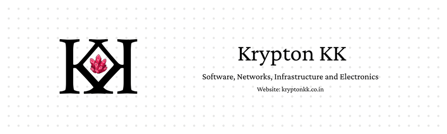

## [GITLAB INSTANCE](https://git.kryptonkk.co.in/)
## [PORTFOLIO REPO](https://git.kryptonkk.co.in/portfolio)

## About Me

- Hey Y'all!! I'm an **Electronics & Computer Engineer** at VIT Chennai.
- I also am persuing an online BS degree in **Data Science And Its Applications** at IIT Madras.
- I do try to learn new stuff constantly cause thats what makes me feel happy and satisfied.
- I am **still trying to find my niche**. Im a generalist by nature so finding a specialisation feels a bit too hard for me ATM. But i think it will be in this domain of networking and infra management that i have now discovered...
- I like to use AI a lot, so most of my codebases that are there (they are usually for funsies i don't use ai that much in prod) in my gitlab instance are ai generated. though i like to maintain a bit of code quality in some of the repos (the serious ones i use for my homelab and stuff) the main reason for putting it there is to not contribute to the ai crisis github is going through currently.

| | |
|------|----|
| I am currently learning |  |
|I Love Handcoding in |  |
| I Love Using AI with |  |

## Current WIP Projects:
- **[Vajra](https://git.kryptonkk.co.in/portfolio/vajra)** - A Open Source Router Hardware (hopefully)
- **[Prometheus 60](https://git.kryptonkk.co.in/portfolio/keyboards/prometheus60)** - 60 key corne style custom keyboard based on a esp32c3 mini
- VLSI projects for fpga and asic (laying out the foundation rn will update this when i am done with it)
- And some AI based & AI powered "internal tooling" software projects for my homelab

## Tech Stack

### Primary Languages/Stack:
###  - Backend APIs and AI Pipelining/Agentic Loops
###  - Userland Network Software and Backend APIs

### Other Languages That I Know

### Databases and Query Languages

### Frameworks & Libraries
#### Web Dev

#### Backends (python)

#### Mobile and Multiplatform

<!--  -->
